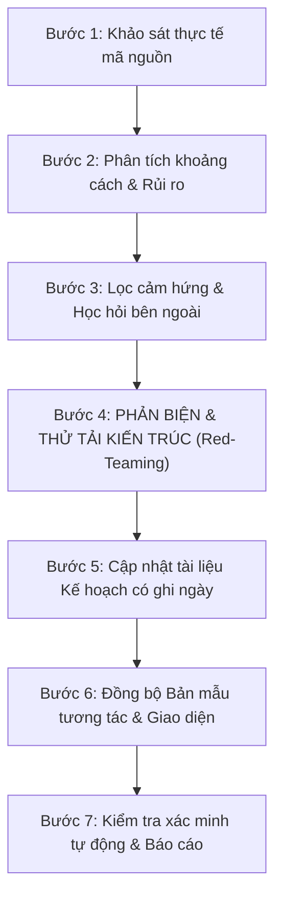

# Lingora Plan & Architecture Synchronization Flow

Quy trình chuẩn hóa để đánh giá (review), cập nhật kế hoạch (plan update), và đồng bộ hóa giữa **Tài liệu kiến trúc (`docs/`)**, **Mã nguồn thực tế (`apps/`, `packages/`)**, và **Bản mẫu tương tác (`prototype/`)**.

## 1. Nguyên tắc cốt lõi bất biến (Invariants)
Trước khi đề xuất hoặc ghi nhận bất kỳ thay đổi nào trong kế hoạch, luôn kiểm tra các bất biến sau từ `ARCHITECTURE.md`:
```text
Observation != Evidence != Mastery
Exposure != Practice Opportunity != Evidence Opportunity
Skipped != Failed | Technical failure != Learner failure
Language Capability != IELTS Strategy != IELTS Performance
```
- **Mã nguồn là sự thật duy nhất (Code reality over paper plans):** Chỉ đánh dấu `DONE` khi có bằng chứng kiểm thử tự động và luồng người dùng hoạt động.
- **Tiếp cận Lát cắt dọc (Vertical-slice first):** Hoàn thiện và kiểm chứng trọn vẹn một lát cắt trước khi mở rộng lát cắt tiếp theo.
- **Phân loại rõ ràng:** `NOW` (ngay trong slice), `PROTECT` (seam kiến trúc/bất biến), `LATER` (tính năng mở rộng, AI scoring).

## 2. Quy trình 7 bước (The 7-Step Synchronization Flow)


- **Bước 1 (Khảo sát thực tế):** Kiểm tra `apps/api/supabase/migrations/`, `packages/contracts/`, `apps/web/src/`.
- **Bước 2 (Khoảng cách & Rủi ro):** Điểm nghẽn ở đâu? Nếu học viên dùng 28 ngày thì chỗ nào gãy trước?
- **Bước 3 (Học hỏi & Chắt lọc):** Tiếp thu ưu điểm UI/UX (Grammar pieces, Soft Study, 6-part ForumFlash) không phá vỡ tính sư phạm.
- **Bước 4 (Phản biện & Thử tải):** Chạy 4 pha phản biện qua 5 lăng kính (Sư phạm, Mất gốc, Kỹ thuật, Lỗi biên, Cắt tỉa).
- **Bước 5 (Cập nhật Kế hoạch):** Ghi nhật ký vào `docs/09-implementation/plan-review-YYYY-MM-DD.md`.
- **Bước 6 (Đồng bộ Bản mẫu):** Cập nhật prototype và UI components.
- **Bước 7 (Xác minh tự động):** Chạy `pnpm --filter @lingora/web typecheck` và xuất báo cáo.

## 3. Tài liệu Tham Chiếu Chuyên Sâu (On-Demand References)
- Chi tiết 4 Pha Phản biện & 5 Lăng kính thử thách: [references/red-teaming-protocol.md](references/red-teaming-protocol.md)
