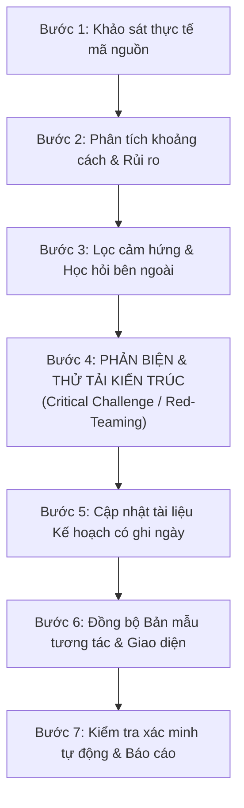
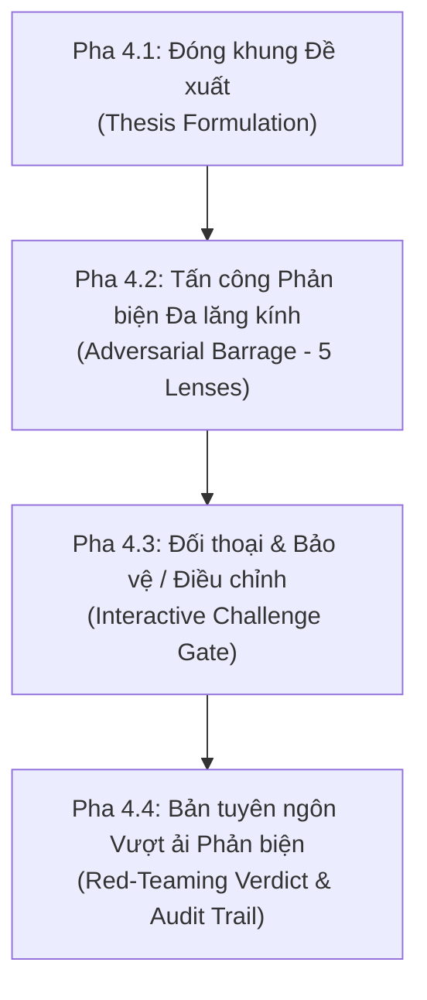

# Lingora Plan & Architecture Synchronization Flow

Quy trình chuẩn hóa để đánh giá (review), cập nhật kế hoạch (plan update), và đồng bộ hóa giữa **Tài liệu kiến trúc (`docs/`)**, **Mã nguồn thực tế (`apps/`, `packages/`)**, và **Bản mẫu tương tác (`prototype/`)**.

## 1. Nguyên tắc cốt lõi bất biến (Invariants)

Trước khi đề xuất hoặc ghi nhận bất kỳ thay đổi nào trong kế hoạch, luôn kiểm tra các bất biến sau từ `ARCHITECTURE.md`:

```text
Observation != Evidence
Evidence != Mastery
Learning Claim != Competency
Exposure != Practice Opportunity != Evidence Opportunity
Activity != Valid Performance Opportunity
Skipped != Failed
Technical failure != Learner failure
Language Capability != IELTS Strategy != IELTS Performance
```

- **Mã nguồn là sự thật duy nhất (Code reality over paper plans):** Không đánh dấu một tính năng là `DONE` chỉ vì tài liệu mô tả nó hoặc có bảng database. Chỉ đánh dấu `DONE` khi có bằng chứng kiểm thử tự động và luồng người dùng hoạt động.
- **Tiếp cận Lát cắt dọc (Vertical-slice first):** Hoàn thiện và kiểm chứng trọn vẹn một lát cắt (Content + UI + API + Data + Pedagogy + Accessibility) trước khi mở rộng lát cắt tiếp theo.
- **Phân loại NOW / PROTECT / LATER rõ ràng:**
  - `NOW`: Việc cần làm ngay trong slice hiện tại.
  - `PROTECT`: Các seam kiến trúc, bất biến và dữ liệu cần bảo vệ, không được làm tắt gây nợ kỹ thuật.
  - `LATER`: Các tính năng mở rộng (AI scoring, universal SRS, IELTS prediction) tuyệt đối không kéo vào sớm khi nền tảng chưa chứng minh xong.

---

## 2. Quy trình 7 bước (The 7-Step Synchronization & Challenge Flow)

Mỗi lần nhận yêu cầu *"review lại plan"*, *"cập nhật kế hoạch"*, hoặc *"thực hiện cải tiến kế hoạch"*, thực hiện tuần tự theo 7 bước:



---

### Bước 1: Khảo sát thực tế mã nguồn (Code Reality Audit)
*Mục tiêu: Biết chính xác hệ thống đang có gì, không suy đoán.*
- Kiểm tra các migration mới nhất trong `apps/api/supabase/migrations/`.
- Kiểm tra các model/DTO trong `packages/contracts/`.
- Kiểm tra trạng thái git (`git status -s`) và các tiến trình nền đang chạy để tránh ghi đè lên file đang sửa.
- Kiểm tra các endpoint API và dịch vụ domain hiện có trong `apps/api/src/modules/`.
- Kiểm tra các trang và component hiện có trong `apps/web/src/`.

---

### Bước 2: Phân tích khoảng cách & Rủi ro (Gap & Risk Analysis)
*Mục tiêu: Đối chiếu giữa mục tiêu của Milestone hiện tại (ví dụ: M1 Slice 01) với mã nguồn.*
- Xác định điểm nghẽn nghiêm trọng nhất:
  - Tốc độ sản xuất nội dung (Content Velocity)?
  - Hạ tầng lưu trữ bài nộp (Audio/Writing Artifacts)?
  - Thuật toán điều phối (Planner v1, Spaced Retrieval, Recovery)?
  - Cơ chế cách ly lỗi (Content Quarantine)?
- Đặt câu hỏi: *Nếu học viên dùng thử 28 ngày ngay bây giờ, chỗ nào sẽ gãy trước tiên?*

---

### Bước 3: Đánh giá cảm hứng & Học hỏi bên ngoài (External Inspiration Integration)
*Mục tiêu: Học hỏi ưu điểm UI/UX từ các sản phẩm thực tế (ví dụ: ForumFlash, Duolingo, Memrise) mà không đánh mất tính nghiêm cẩn của Lingora.*
- Lọc các ý tưởng giao diện tốt:
  - Cách trực quan hóa cấu trúc ngữ pháp (Grammar Pieces).
  - Biểu tượng sinh trưởng tự nhiên (Learning Garden / Tree) thay cho streak trừng phạt.
  - Phân chia bước học rõ ràng: Tiếp xúc $\rightarrow$ Luyện tập $\rightarrow$ Độc lập.

---

### Bước 4: QUY TRÌNH PHẢN BIỆN TƯƠNG TÁC & THỬ TẢI KIẾN TRÚC (The Interactive Red-Teaming Flow)
*Mục tiêu: Đóng vai "Người phản biện khắt khe" (Devil's Advocate / Red Team Leader) để chủ động chất vấn, phát hiện lỗ hổng, ảo tưởng năng lực, nợ kỹ thuật và sự phức tạp hóa không cần thiết TRƯỚC KHI bất kỳ thay đổi nào được ghi vào kế hoạch hoặc mã nguồn.*

Quy trình phản biện phải diễn ra minh bạch qua **4 pha tuần tự (4-Phase Red-Teaming Protocol)**:



#### Pha 4.1: Đóng khung Đề xuất (Thesis Formulation)
- AI tóm tắt ngắn gọn đề xuất điều chỉnh kế hoạch hoặc tính năng:
  - **Mục tiêu thay đổi:** Giải quyết vấn đề gì?
  - **Lát cắt ảnh hưởng:** Tác động đến thành phần nào (`Content`, `Data/Migrations`, `API`, `UI/UX`, `Testing`)?
  - **Phân loại dự kiến:** Thuộc nhóm `NOW`, `PROTECT`, hay `LATER`?

#### Pha 4.2: Tấn công Phản biện Đa lăng kính (The 5-Lens Adversarial Challenge)
AI chủ động đưa ra các đòn chất vấn trực diện qua 5 lăng kính bắt buộc:

1. **Lăng kính Sư phạm & Đo lường (Pedagogical Stress-Test):**
   - Đề xuất này có vô tình tạo ra *ảo tưởng thành thạo* (mastery illusion) không?
   - Có vi phạm ranh giới `Exposure != Practice != Evidence` không?
   - Có biến việc học thành trò chơi điểm số (XP, streak áp lực) làm sai lệch bản chất không?
   - *Nếu có rủi ro: Đề xuất phương án triệt tiêu ảo tưởng năng lực.*

2. **Lăng kính Người học Mất gốc (Beginner Reality Check):**
   - Một người mới bắt đầu học tiếng Anh (vốn từ yếu, phát âm ngại ngùng) có hiểu được giao diện/nội dung này trong 5 giây đầu không?
   - Từ ngữ hiển thị có quá hàn lâm, trừu tượng hay gây hoang mang không?
   - *Nếu có rủi ro: Đơn giản hóa ngôn ngữ sang tiếng Việt thân thiện, hỗ trợ phiên âm và nghĩa trực tiếp.*

3. **Lăng kính Kỹ thuật & Bền vững (Engineering Simplicity & Seams):**
   - Có đang làm phức tạp hóa quá mức (over-engineering) cho một yêu cầu đơn giản không?
   - Có phá vỡ tính phân tầng `Next.js -> NestJS -> Supabase` không? Có để client ghi thẳng dữ liệu đánh giá không?
   - *Nếu có rủi ro: Rút gọn giải pháp về mức tối giản nhất thỏa mãn yêu cầu.*

4. **Lăng kính Sự cố & Tình huống biên (Failure & Degraded Modes):**
   - Khi micro bị từ chối, file audio tải lên lỗi, mạng bị rớt, dữ liệu bài làm của học viên có được bảo toàn không?
   - Lỗi kỹ thuật có bị hệ thống phạt nhầm thành "học viên kém" (`Technical failure != Learner failure`) không?
   - *Nếu có rủi ro: Bắt buộc phải có luồng thay thế (fallback) và thông báo lỗi kỹ thuật rõ ràng.*

5. **Lăng kính Cắt tỉa Phạm vi (NOW vs LATER Brutal Pruning):**
   - Hạng mục này có **bắt buộc** phải có để hoàn thành Vertical Slice hiện tại không?
   - Nếu KHÔNG làm điều này ngay hôm nay, hệ thống có chứng minh được luồng học không?
   - *Nếu hệ thống vẫn kiểm chứng được: Kiên quyết chuyển ngay sang LATER, không thêm vào NOW.*

#### Pha 4.3: Đối thoại & Bảo vệ / Điều chỉnh (Interactive Challenge Gate)
- AI trình bày các chất vấn phản biện này ra trao đổi trực tiếp với người dùng (có thể sử dụng công cụ hỏi trực tiếp hoặc câu hỏi có phương án rõ ràng).
- Mỗi luận điểm chất vấn chỉ có thể kết thúc ở 1 trong 3 trạng thái:
  - **`DEFENDED` (Bảo vệ thành công):** Có luận cứ kiến trúc hoặc sư phạm vững chắc $\rightarrow$ Giữ trong `NOW`.
  - **`REFACTORED` (Tái cấu trúc / Tối giản hóa):** Giảm độ phức tạp, bổ sung cơ chế fallback bảo vệ người học $\rightarrow$ Cập nhật lại phạm vi `NOW`.
  - **`REJECTED / LATER` (Bác bỏ / Dời lại):** Không vượt qua được bài toán cắt tỉa phạm vi $\rightarrow$ Chuyển dứt khoát sang danh mục `LATER`.

#### Pha 4.4: Bản tuyên ngôn Vượt ải Phản biện (Red-Teaming Verdict & Audit Trail)
- Tổng hợp kết quả phản biện thành bảng chuẩn hóa để đưa vào tài liệu kế hoạch:
  | Hạng mục đề xuất | Lăng kính thử thách | Rủi ro phát hiện | Kết luận (`DEFENDED` / `REFACTORED` / `LATER`) | Giải pháp thống nhất |
  |---|---|---|---|---|
- **Điều kiện mở khóa Bước 5:** Chỉ khi Pha 4.4 có kết luận rõ ràng cho toàn bộ các điểm chất vấn, quy trình mới được chuyển sang Bước 5 để ghi nhận vào tài liệu chính thức.

---

### Bước 5: Cập nhật tài liệu Kế hoạch (Documenting the Plan)
*Mục tiêu: Lưu vết kế hoạch chính thức vào kho tài liệu.*
- Tạo hoặc cập nhật file ghi nhận kế hoạch có gắn ngày trong `docs/09-implementation/` (ví dụ: `plan-review-YYYY-MM-DD.md`).
- Cấu trúc bắt buộc:
  1. **Bảng đối chiếu Hiện trạng vs Yêu cầu** (Code reality table).
  2. **Top các rủi ro cốt lõi** (Top risks).
  3. **Kết quả phản biện (Critical Challenge findings)**.
  4. **Thứ tự công việc NOW được sắp xếp lại** kèm điều kiện hoàn thành ("Xong khi nào").
  5. **Những điều kiên quyết không thay đổi** (Explicitly not changed).
- Cập nhật liên kết từ file tổng quan `overview.md` và file slice hiện tại `slices/01-*.md`.

---

### Bước 6: Đồng bộ Bản mẫu tương tác & Giao diện (Prototype & UI Synchronization)
*Mục tiêu: Đưa ý tưởng đã vượt qua phản biện vào môi trường thử nghiệm tương tác trước khi sửa code backend sâu.*
- Cập nhật bản mẫu tại `prototype/` (hoặc `apps/web/public/prototype/`):
  - Áp dụng các quy chuẩn `ui-ux-pro-max` (WCAG 2.1 AA, touch targets $\ge 44\text{px}$, contrast $\ge 4.5:1$).
  - Thêm các trường hợp giả lập lỗi kỹ thuật (micro từ chối, mạng ngắt, âm thanh hỏng).
- Cập nhật frontend Next.js (`apps/web`):
  - Đảm bảo các route `/prototype` và các liên kết Dashboard hoạt động liền mạch.

---

### Bước 7: Kiểm tra xác minh tự động & Báo cáo minh bạch (Verification & Transparent Reporting)
*Mục tiêu: Bảo đảm hệ thống không bị lỗi build hay gãy contract.*
- Chạy kiểm tra:
  ```powershell
  pnpm --filter @lingora/web typecheck
  pnpm --filter @lingora/web lint
  pnpm --filter @lingora/web build
  ```
- Báo cáo rõ ràng cho người dùng:
  - Các phát hiện qua bước Phản biện.
  - Những gì đã được cập nhật trong tài liệu kế hoạch.
  - Những gì đã được đưa vào bản mẫu hoặc mã nguồn.
  - Hành động cụ thể tiếp theo được khuyến nghị.

