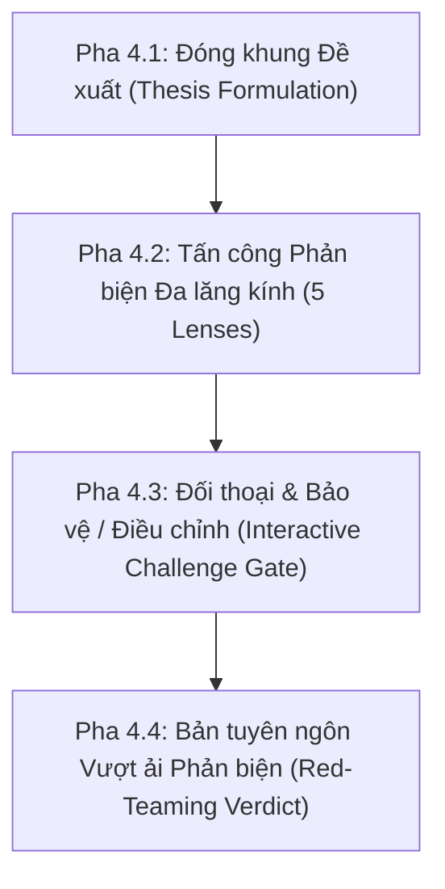

# The Interactive Red-Teaming Flow & Synchronization Details

Tài liệu tham chiếu chi tiết cho `lingora-plan-flow` (Nạp theo nhu cầu khi thực hiện review sâu).

## 1. Quy Trình Phản Biện 4 Pha (4-Phase Red-Teaming Protocol)

### Pha 4.1: Đóng khung Đề xuất
- **Mục tiêu thay đổi:** Giải quyết vấn đề gì?
- **Lát cắt ảnh hưởng:** `Content`, `Data/Migrations`, `API`, `UI/UX`, `Testing`?
- **Phân loại dự kiến:** `NOW`, `PROTECT`, hay `LATER`?

### Pha 4.2: Tấn công Phản biện Đa lăng kính (5 Lenses)
1. **Lăng kính Sư phạm & Đo lường:** Không tạo ảo tưởng thành thạo; tuân thủ `Exposure != Practice != Evidence`.
2. **Lăng kính Người học Mất gốc:** Hiểu được trong 5 giây đầu; tiếng Việt thân thiện, phiên âm trực quan.
3. **Lăng kính Kỹ thuật & Bền vững:** Không over-engineering; giữ tính phân tầng `Next.js -> NestJS -> Supabase`.
4. **Lăng kính Sự cố & Tình huống biên:** Fallback khi micro bị từ chối/mạng rớt; `Technical failure != Learner failure`.
5. **Lăng kính Cắt tỉa Phạm vi:** Cần thiết cho slice hiện tại không? Không thì dời sang `LATER`.

### Pha 4.3: Đối thoại & Phân giải
- `DEFENDED`: Có cơ sở vững chắc $\rightarrow$ Giữ `NOW`.
- `REFACTORED`: Tối giản hóa, thêm fallback $\rightarrow$ Cập nhật `NOW`.
- `REJECTED / LATER`: Cắt tỉa $\rightarrow$ Dời sang `LATER`.

### Pha 4.4: Bản tuyên ngôn Vượt ải
| Hạng mục đề xuất | Lăng kính thử thách | Rủi ro phát hiện | Kết luận | Giải pháp thống nhất |
|---|---|---|---|---|

---

## 2. Các Bước Cập Nhật Kế Hoạch & Kiểm Chứng (Bước 5-7)
- **Bước 5: Cập nhật tài liệu Kế hoạch:** Tạo/cập nhật `docs/09-implementation/plan-review-YYYY-MM-DD.md`.
- **Bước 6: Đồng bộ Bản mẫu tương tác:** Cập nhật route `/prototype` và các component mẫu.
- **Bước 7: Kiểm tra xác minh tự động:** Chạy `pnpm --filter @lingora/web typecheck` và báo cáo kết quả.
