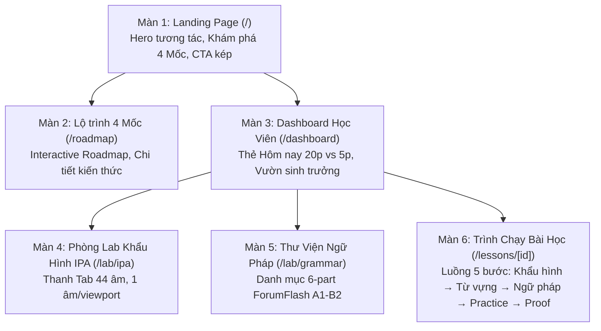

# Sơ Đồ Phân Cấp Màn Hình (Screen Hierarchy & Navigation Flow — Phase 02)

## Bảng Đặc Tả Màn Hình:
| Mã Màn | Tên Màn Hình & Tuyến Đường | Mục Tiêu & Trải Nghiệm Cốt Lõi |
| :---: | :--- | :--- |
| **SCR-01** | Landing Page (`/`) | Giới thiệu phương pháp học không áp lực, Hero canvas 60fps, nút Dùng thử không cần đăng nhập |
| **SCR-02** | Lộ trình 4 Mốc (`/roadmap`) | Trực quan hóa 4 chặng từ A1 (3.0) đến B2 (6.5), danh sách chủ đề và dạng bài test |
| **SCR-03** | Dashboard (`/dashboard`) | Thẻ bài học gợi ý hôm nay (20 phút tiêu chuẩn vs 5 phút cứu nguy), lời chào êm dịu |
| **SCR-04** | Lab IPA (`/lab/ipa`) | Xem khẩu hình 2 góc SVG, luyện phát âm chuẩn/chậm, thu âm thử giọng |
| **SCR-05** | Lab Ngữ Pháp (`/lab/grammar`) | Thư viện ngữ pháp 6 phần mổ xẻ màu sắc (Chủ ngữ - Động từ - Tân ngữ) |
| **SCR-06** | Lesson Runner (`/lessons/[id]`) | Trình chạy bài học 5 bước, tích hợp Modal `⚙ Giả lập lỗi kỹ thuật` cho QA |
