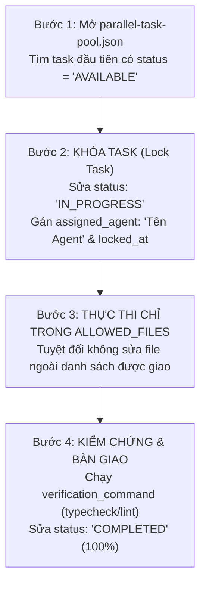

# ⚡ GIAO THỨC ĐIỀU PHỐI TASK SONG SONG ĐA AGENT (MULTI-AGENT CONCURRENCY PROTOCOL)

**Đường dẫn tài liệu:** `docs/09-implementation/active-plans/MULTI-AGENT-CONCURRENCY-PROTOCOL.md`  
**File điều phối trung tâm (Shared State JSON):** [`.agents/coordination/parallel-task-pool.json`](../../../.agents/coordination/parallel-task-pool.json)  
**Mục tiêu tối thượng:** Cho phép **3 đến 5 AI Agents** (Antigravity, Codex Tab 1, Codex Tab 2, Claude Code...) cùng lúc coding song song với **tốc độ gấp 3–5 lần**, **tuyệt đối không nhận trùng task**, **không ghi đè file của nhau (Zero Conflict)**.

---

## 🔒 1. NGUYÊN TẮC KHÓA TASK NGUYÊN TỬ (ATOMIC TASK LOCKING RULES)

Bất kỳ Agent nào khi bắt đầu phiên làm việc **BẮT BUỘC TUÂN THỦ 3 BƯỚC SAU**:



1. **Quy tắc Kiểm tra trạng thái:** Agent **chỉ được nhận task** có `"status": "AVAILABLE"`. Nếu thấy task đã là `"IN_PROGRESS"` hoặc `"COMPLETED"`, lập tức bỏ qua và lấy task kế tiếp.
2. **Quy tắc Khóa Task (Atomic Lock):** Ngay trước khi viết dòng code đầu tiên, Agent phải cập nhật file [`.agents/coordination/parallel-task-pool.json`](../../../.agents/coordination/parallel-task-pool.json):
   ```json
   "status": "IN_PROGRESS",
   "assigned_agent": "Codex-Agent-2",
   "locked_at": "2026-10-21T16:15:00+07:00",
   "progress_percentage": 10
   ```
3. **Quy tắc Thư mục Cô Lập (Directory Isolation):** Agent chỉ được phép tạo hoặc sửa các file nằm trong mảng `"allowed_files"` của task đó. Mọi file bên ngoài đều thuộc quyền sở hữu của Agent khác.
4. **Quy tắc Nghiệm thu & Mở khóa:** Khi hoàn thành, Agent chạy lệnh kiểm chứng (`verification_command`), cập nhật `"status": "COMPLETED"`, `"progress_percentage": 100`, rồi mới kết thúc phiên.

---

## 📋 2. BẢNG PHÂN CHIA 6 TASK SONG SONG HIỆN TẠI (THE 6 PARALLEL TASKS)

| Mã Task | Giai Đoạn | Tên Công Việc Cụ Thể | Thư Mục / File Được Phép Sửa (`allowed_files`) | Trạng Thái Hiện Tại |
| :---: | :---: | :--- | :--- | :---: |
| **`TASK-2A`** | **Phase 2** | **Trang Lộ Trình 4 Mốc IELTS 6.5 (`/roadmap`)**<br>Interactive Tab 4 Mốc, Chi tiết kiến thức & Dạng đề test | • `apps/web/src/app/roadmap/page.tsx`<br>• `apps/web/src/components/roadmap/milestone-card.tsx`<br>• `apps/web/src/components/roadmap/roadmap-interactive-view.tsx` | 🟢 **AVAILABLE** |
| **`TASK-2B`** | **Phase 2** | **Nâng Cấp Landing Page (`/`) Chuẩn SaaS**<br>Hero tương tác, CTA kép, Footer bản quyền & tài liệu | • `apps/web/src/app/page.tsx`<br>• `apps/web/src/components/common/footer.tsx` | 🟢 **AVAILABLE** |
| **`TASK-3A`** | **Phase 3** | **Phòng Lab 44 Âm IPA Toàn Diện (`/lab/ipa`)**<br>Bảng tra cứu 44 âm, lọc nguyên âm/phụ âm (1 âm/viewport) | • `apps/web/src/app/lab/ipa/page.tsx`<br>• `apps/web/src/components/ipa/ipa-full-chart.tsx` | 🟢 **AVAILABLE** |
| **`TASK-3B`** | **Phase 3** | **Thư Viện Masterclass Ngữ Pháp (`/lab/grammar`)**<br>Danh mục bài giảng 6 phần A1 $\rightarrow$ B2 ForumFlash | • `apps/web/src/app/lab/grammar/page.tsx`<br>• `apps/web/src/components/grammar/grammar-catalog.tsx` | 🟢 **AVAILABLE** |
| **`TASK-3C`** | **Phase 3** | **Nâng Cấp Dashboard Học Viên (`/dashboard`)**<br>Thẻ Hôm nay 20p vs 5p, chào đón khi nghỉ học quay lại | • `apps/web/src/features/dashboard/dashboard-view.tsx`<br>• `apps/web/src/features/dashboard/today-action-card.tsx` | 🟢 **AVAILABLE** |
| **`TASK-4A`** | **Phase 4** | **Lesson Runner 5 Bước Chuẩn Mực (`/lessons`)**<br>Luồng: Khẩu hình $\rightarrow$ Từ vựng $\rightarrow$ Ngữ pháp $\rightarrow$ Runner $\rightarrow$ Proof | • `apps/web/src/features/lesson/lesson-view.tsx`<br>• `apps/web/src/features/lesson/lesson-step-runner.tsx` | 🟢 **AVAILABLE** |

---

## 🤖 3. MẪU PROMPT GIAO VIỆC TỰ ĐỘNG CHO CODEX / AGENT BẤT KỲ

Khi bạn mở một cửa sổ mới cho OpenAI Codex hoặc Claude Code, bạn chỉ cần **copy nguyên văn** đoạn prompt dưới đây. Agent sẽ **tự động đọc file JSON, tự chọn task đang trống và tự khóa task**:

```text
Bạn là một AI Agent tham gia lập trình dự án Lingora (D:\Lingora).
Nhiệm vụ của bạn:
1. Đọc ngay file .agents/coordination/parallel-task-pool.json
2. Tìm task đầu tiên có "status": "AVAILABLE".
3. Khóa task đó lại bằng cách đổi "status" thành "IN_PROGRESS", điền "assigned_agent" là tên của bạn, và cập nhật "locked_at".
4. Đọc quy chuẩn nghiệm thu tại: docs/09-implementation/active-plans/completion-criteria.md
5. Thực hiện code CHỈ TRONG các file thuộc "allowed_files" của task đó.
6. Khi xong, chạy: pnpm --filter @lingora/web typecheck. Nếu Pass 100%, hãy cập nhật "status": "COMPLETED", "progress_percentage": 100 vào parallel-task-pool.json.
```
