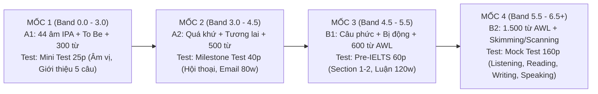

# ⚡ KẾ HOẠCH TRIỂN KHAI TỔNG THỂ DUY NHẤT (THE UNIFIED MASTER PLAN)
### Single Source of Truth Cho Mọi AI Agent (Antigravity, Codex, Claude Code...)

**Đường dẫn file:** `docs/09-implementation/active-plans/UNIFIED-MASTER-PLAN.md`  
**Cập nhật lần cuối:** 2026-10-21 (Đã hoàn thành toàn bộ Core UI Components Làn 1-4)  
**Quy tắc bất biến:** Bất kỳ Agent nào khi vào dự án chỉ cần mở **đúng file này** là biết ngay: **Tiến độ dự án đang ở đâu**, **Task tiếp theo cần làm là gì**, **Quy chuẩn nghiệm thu ra sao**, và **Thư mục nào được phép sửa**.

---

## 🚦 1. BẢNG TIẾN ĐỘ THỜI GIAN THỰC (REAL-TIME PROGRESS BOARD)

> **Nhìn vào đây trong 3 giây để biết cần làm gì tiếp theo:**

| Giai Đoạn (Phase) | Nội Dung Công Việc Chính | Trạng Thái | Tiến Độ (%) | Agent Đảm Nhiệm & Lệnh Xác Minh |
| :---: | :--- | :---: | :---: | :--- |
| **PHASE 1** | **Xây Dựng Core Components UI/UX (Chuẩn Prototype 100%)**<br>• Canvas nền 60fps & HeaderNav (`components/common/`)<br>• Phòng Lab IPA 1 âm/viewport (`components/ipa/`)<br>• Masterclass Ngữ pháp 6 phần (`components/grammar/`)<br>• Runner luyện tập & QA Modal (`components/practice/`) | 🟢 **COMPLETED** | **100%** | **Đã xong & Verified 100%**<br>`pnpm --filter @lingora/web typecheck` (Pass) |
| **PHASE 2** | **Trang Lộ Trình 4 Mốc IELTS 6.5 (`/roadmap`) & Landing Page (`/`)**<br>• Trang `/roadmap` tương tác chuyển đổi 4 Mốc (A1 $\rightarrow$ 6.5)<br>• Hiển thị chi tiết kiến thức & dạng bài test cho từng mốc<br>• Cập nhật Landing Page (`/`) đồng bộ Header/Footer chuẩn SaaS | 🟡 **TIẾP THEO (IN QUEUE)** | **0%** | 👉 **TASK CẦN LÀM NGAY**<br>Target: `apps/web/src/app/roadmap/` & `page.tsx` |
| **PHASE 3** | **Khu Vực Học Viên: Dashboard & Thư Viện Phòng Lab Tự Do**<br>• Trang `/dashboard` Thẻ Hôm nay (Học 20p vs Học nhẹ 5p)<br>• Trang chuyên biệt Lab 44 âm IPA (`/lab/ipa`)<br>• Trang Thư viện Masterclass Ngữ pháp (`/lab/grammar`) | ⏳ CHỜ PHASE 2 | **0%** | Target: `apps/web/src/app/dashboard/` & `/lab/` |
| **PHASE 4** | **Lesson Runner 5 Bước Chuẩn Mực (`/lessons/[lessonId]`)**<br>• Nối luồng: Khẩu hình $\rightarrow$ Từ vựng $\rightarrow$ Ngữ pháp $\rightarrow$ Runner $\rightarrow$ Ghi nhận<br>• Tích hợp cứu hộ kỹ thuật khi mất mic / audio lỗi | ⏳ CHỜ PHASE 3 | **0%** | Target: `apps/web/src/features/lesson/` |
| **PHASE 5** | **Tích Hợp API Supabase, Lưu Tiến Độ Đám Mây & Deploy**<br>• Lưu kết quả học viên vào PostgreSQL qua NestJS API<br>• Chế độ Khách (Guest mode) lưu `localStorage`<br>• Playwright E2E & Triển khai Production Vercel | ⏳ CHỜ PHASE 4 | **0%** | Target: `apps/api/` & `qa/e2e/` |

---

## 🗺️ 2. LỘ TRÌNH 4 MỐC HỌC & MA TRẬN DẠNG BÀI TEST ĐẾN IELTS 6.5

*(Chi tiết kiến thức & dạng test tham chiếu tại [`ielts-milestones-and-test-specs.md`](ielts-milestones-and-test-specs.md))*



---

## ⚖️ 3. QUY CHUẨN NGHIỆM THU ĐÓNG BĂNG CHO MỌI AGENT

*(Tham chiếu đầy đủ tại [`completion-criteria.md`](completion-criteria.md))*

1. **Hiến pháp Sư phạm:**
   - Bấm `Bỏ qua` / `Để sau` $\rightarrow$ **Tuyệt đối không trừ điểm, không báo lỗi đỏ** (`Skipped != Failed`).
   - Bấm `Gợi ý` $\rightarrow$ Tự động gán nhãn `has_support: true`, không tính vào bằng chứng độc lập.
2. **Quy chuẩn Giao diện (IPA & Layout):**
   - Phòng Lab IPA: Bắt buộc **1 âm / viewport**, chuyển âm bằng Tab con thoi.
   - **100% nhãn text mô tả khẩu hình phải nằm ngoài thẻ `<svg>` bằng HTML** chống tràn viền trên mobile 390px.
   - Ngữ pháp đủ **6 phần ForumFlash** (Bản chất, Chức năng, Chia ngôi, Cấu trúc 3 thể, Dấu hiệu, Mổ xẻ câu).
3. **Chịu lỗi kỹ thuật:** Khi mất mic / lỗi audio $\rightarrow$ Thông báo êm dịu: *"Đây là lỗi kỹ thuật, không phải lỗi của bạn"* và mở luồng gõ văn bản thay thế.
4. **Lệnh nghiệm thu kỹ thuật:** Trước khi bàn giao task, bắt buộc chạy lệnh:
   ```powershell
   pnpm --filter @lingora/web typecheck  # Phải 0 error
   pnpm --filter @lingora/web lint       # Phải 0 warning
   ```

---

## 🚀 4. PHẠM VI TASK TIẾP THEO (PROMPT SẴN CHO AGENT BẮT ĐẦU NGAY)

> **Agent tiếp theo (hoặc phiên làm việc mới) thực hiện ngay nhiệm vụ sau:**

- **Nhiệm vụ:** Thực hiện **PHASE 2**: Xây dựng trang Lộ trình 4 Mốc IELTS 6.5 (`apps/web/src/app/roadmap/page.tsx`) và nâng cấp Landing Page (`apps/web/src/app/page.tsx`).
- **Thư mục làm việc:** `apps/web/src/app/roadmap/`, `apps/web/src/components/roadmap/`, `apps/web/src/app/page.tsx`.
- **Yêu cầu:** 
  1. Trang `/roadmap` có bộ Tab tương tác chuyển đổi giữa 4 Mốc (Mốc 1: 0-3.0, Mốc 2: 3.0-4.5, Mốc 3: 4.5-5.5, Mốc 4: 5.5-6.5).
  2. Mỗi mốc thể hiện rõ: Danh mục kiến thức phát âm/từ vựng/ngữ pháp và định dạng bài test tương ứng.
  3. Chạy `pnpm --filter @lingora/web typecheck` đạt Pass 100%.
