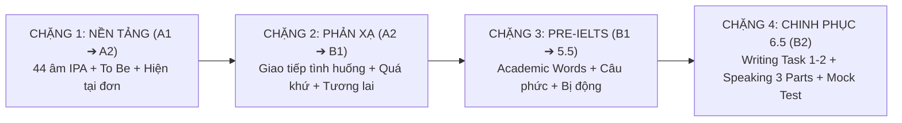

# 🎯 LỘ TRÌNH ĐẦY ĐỦ TỪ MẤT GỐC (A1) ĐẾN IELTS 6.5 ACADEMIC (B2)
### Chuẩn Hóa Triết Lý ForumFlashStudy (2-Step Route & Growth Garden)

**Đường dẫn tài liệu:** `docs/09-implementation/active-plans/ielts-6-5-roadmap.md`  
**Trạng thái:** 🟢 **ĐÃ ĐẶC TẢ CHI TIẾT 100% — SẴN SÀNG LÊN CODE**  
**Cam kết chất lượng:** Rõ ràng từng ngày, từng tuần, từng kỹ năng (*Listening 6.5, Reading 6.5, Writing 6.0, Speaking 6.5*), không phán đoán ảo.

---

## 🗺️ 1. TỔNG QUAN 4 CHẶNG ĐẾN 6.5 IELTS ACADEMIC

---

## 📊 2. MA TRẬN 4 CHẶNG CHI TIẾT ĐẾN 6.5

| Tiêu Chí | Chặng 1: Nền Tảng (A1 $\rightarrow$ A2) | Chặng 2: Phản Xạ (A2 $\rightarrow$ B1) | Chặng 3: Tiền IELTS (B1 $\rightarrow$ 5.5) | Chặng 4: Cán Đích IELTS 6.5 (B2) |
| :--- | :--- | :--- | :--- | :--- |
| **Mục tiêu CEFR / Band** | **A1 $\rightarrow$ A2** (Mất gốc) | **A2 $\rightarrow$ B1** (~4.0 - 4.5 IELTS) | **B1 $\rightarrow$ B2.1** (~5.0 - 5.5 IELTS) | **B2 / 6.5 IELTS Academic** |
| **Trọng tâm Phát âm** | 44 âm IPA (1 âm/viewport), trọng âm từ | Nối âm (Linking), Nuốt âm, Ngữ điệu lên xuống | Nhịp điệu câu (Sentence Stress), Intonation học thuật | Lưu loát tự nhiên (Fluency), Không vấp âm cuối |
| **Vốn từ vựng** | 400 từ sinh hoạt cơ bản | 800 từ tình huống đời thường | 1.200 từ vựng chủ đề (Topic-based) | 1.500 từ Academic Word List (AWL) & Collocations |
| **Ngữ pháp 6 phần** | *To be*, Hiện tại đơn, Bảng chia ngôi, Câu hỏi WH- | Quá khứ đơn, Tương lai, So sánh, Động từ khuyết thiếu | Mệnh đề quan hệ, Câu bị động, Câu điều kiện (1, 2) | Đảo ngữ, Cụm phân từ, Danh từ hóa (Nominalisation) |
| **Listening** | Nhận diện âm, tên riêng, số điện thoại | Nghe hội thoại đời thường (tốc độ vừa) | Nghe bài giảng ngắn, ghi chú thông tin | Section 1-4: Đạt 26–29 / 40 câu (Band 6.5) |
| **Reading** | Đọc menu, tin nhắn, đoạn văn 50 từ | Đọc email công việc, bài báo ngắn 200 từ | Đọc bài luận 500 từ, Skimming & Scanning | Passage 1-3: Đạt 27–29 / 40 câu (Band 6.5) |
| **Writing** | Tự viết 3–5 câu giới thiệu bản thân | Viết đoạn văn kể chuyện / nhật ký 80 từ | Viết đoạn văn nghị luận 120 từ có dẫn chứng | Task 1 Báo cáo biểu đồ (150 từ) + Task 2 Luận (250 từ) |
| **Speaking** | Thu âm 20–30s không nuốt âm cuối | Nói tương tác 60–90s giải quyết tình huống | Nói độc thoại Part 2 (1.5 phút) | Trôi chảy 3 Part (A.R.E.A formula), Band 6.5 |
| **Proof Gate** | Tự giới thiệu trôi chảy trước camera/mic | Xử lý được tình huống du lịch/đổi hàng | Tóm tắt được 1 bài nghiên cứu ngắn | Thi thử Mock Test Cambridge đạt 6.5 thực chất |

---

## 🎯 3. TIÊU CHUẨN CHI TIẾT 4 KỸ NĂNG ĐẠT BAND 6.5

### 🎧 1. Listening 6.5 (Đạt 26 - 29 / 40 câu)
- **Part 1 & 2:** Nghe hội thoại đời thường, đặt phòng khách sạn, hỏi đường $\rightarrow$ Tuyệt đối không sai chính tả tên riêng, ngày tháng và mã bưu điện.
- **Part 3 & 4:** Nghe thảo luận học thuật nhóm và bài giảng của giáo sư $\rightarrow$ Nhận diện chính xác từ đồng nghĩa (Paraphrasing) và bẫy người nói thay đổi ý kiến vào phút chót.

### 📖 2. Reading 6.5 (Đạt 27 - 29 / 40 câu)
- Thành thạo kỹ thuật đọc lướt (**Skimming**) nắm ý chính trong 2 phút và đọc quét (**Scanning**) bắt từ khóa trong 30 giây.
- Xử lý mượt mà 3 dạng bài khó nhất: *True / False / Not Given*, *Matching Headings* (Nối tiêu đề đoạn) và *Summary Completion*.

### ✍️ 3. Writing 6.0 - 6.5 (Bố Cục 4 Đoạn Học Thuật)
- **Task 1 (Báo cáo biểu đồ 150 từ):** Viết đủ 4 đoạn: *Introduction $\rightarrow$ Overview (2 xu hướng chính) $\rightarrow$ Body 1 (Số liệu nhóm 1) $\rightarrow$ Body 2 (Số liệu nhóm 2)*. Sử dụng linh hoạt ngôn ngữ xu hướng (*surge, fluctuate, plummet, stabilize*).
- **Task 2 (Bài luận 250 từ):** Áp dụng mô hình **P.E.E.L** (*Point $\rightarrow$ Explanation $\rightarrow$ Example $\rightarrow$ Link*). Lập luận logic, sử dụng liên từ học thuật (*Furthermore, Conversely, Consequently*).

### 🎙️ 4. Speaking 6.5 (Fluency & Coherence)
- **Part 1:** Trả lời theo công thức **A.R.E.A** (*Answer $\rightarrow$ Reason $\rightarrow$ Example $\rightarrow$ Alternative*) dài 3-4 câu tự nhiên.
- **Part 2:** Tận dụng 1 phút nháp để lên dàn ý 4 nhánh, duy trì tốc độ nói liền mạch 1 phút 45 giây đến 2 phút không ngắt quãng quá lâu.
- **Part 3:** Mở rộng câu trả lời theo góc nhìn xã hội, sử dụng các cấu trúc trang trọng (*From my perspective, It is widely believed that...*).
