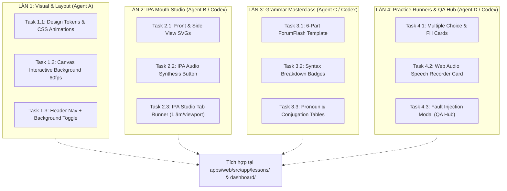

# ⚡ Ma Trận Phân Chia Task Song Song (Parallel Task Matrix for Multi-AI / Codex)

**Đường dẫn tài liệu:** `docs/09-implementation/parallel-tasks-matrix.md`  
**Mục đích:** Thiết kế các gói công việc (Workstreams) hoàn toàn **độc lập, không dẫm chân lên file của nhau (Zero Merge Conflict)**, cho phép **Antigravity** và **Codex** (hoặc nhiều AI Agents) cùng lúc coding song song 100%.

---

## 🧭 Nguyên Tắc Phân Chia Song Song (Concurrency Rules)

1. **Quy tắc Thư mục Cô Lập (Directory Isolation):** Mỗi Agent làm việc trong một cây thư mục con riêng biệt, không chỉnh sửa file của Agent khác khi chưa xong PR/Commit.
2. **Quy tắc Contract First:** Mọi tương tác giữa các component thông qua interface props chuẩn được định nghĩa sẵn trong tài liệu này.
3. **Quy tắc Tự Kiểm Thử Độc Lập:** Mỗi task đều có lệnh verify cục bộ riêng (`pnpm --filter @lingora/web typecheck` hoặc test file tương ứng).

---

## 🚀 4 Làn Công Việc Song Song (4 Independent Workstreams)



---

## 📋 Chi Tiết Từng Làn Công Việc (Task Prompts Sẵn Cho Codex)

### 🌊 LÀN 1: Visual System & Background Canvas (Core Presentation)
- **Tập tin sở hữu riêng:**
  - `apps/web/src/components/common/interactive-background.tsx`
  - `apps/web/src/components/common/header-nav.tsx`
  - `apps/web/src/app/globals.css` (khu vực canvas tokens)
- **Đầu vào:** Port hiệu ứng Canvas từ `prototype/app.js` (hàm `initCanvasMesh`) và `prototype/styles.css`.
- **Yêu cầu kỹ thuật:**
  - Canvas 60fps gradient mesh, floating orbs, phản ứng chuột nhẹ nhàng (`pointermove`).
  - Nút gạt On/Off lưu `localStorage('lingora-bg-fx')`. Tự động giảm frame rate khi tab ẩn.
- **Lệnh verify:** `pnpm --filter @lingora/web typecheck && pnpm --filter @lingora/web lint`

---

### 🌊 LÀN 2: Phòng Lab Khẩu Hình IPA (Mouth Studio)
- **Tập tin sở hữu riêng:**
  - `apps/web/src/components/ipa/ipa-mouth-studio.tsx`
  - `apps/web/src/components/ipa/ipa-front-view.tsx`
  - `apps/web/src/components/ipa/ipa-side-view.tsx`
  - `apps/web/src/components/ipa/ipa-formula-badge.tsx`
  - `apps/web/src/components/common/audio-button.tsx`
- **Đầu vào:** Tham khảo mã nguồn từ `prototype/index.html` và `prototype/app.js` (các hàm render IPA `/iː/`, `/ɪ/`, `/p/`, `/b/`, `/s/`, `/z/`).
- **Yêu cầu kỹ thuật (Bất biến):**
  - **1 âm IPA / viewport**: Điều hướng bằng Tab chọn âm, không để tràn màn hình.
  - 2 hình SVG: `1. NHÌN THẲNG (MÔI & RĂNG)` và `2. MẶT CẮT NGANG (LƯỠI & HƠI)`.
  - **Mọi text nhãn chú thích phải nằm ngoài thẻ SVG** bằng HTML thuần (`div.mouth-spec-item`), không được nhúng cứng `<text>` trong SVG.
  - Component `AudioButton` hỗ trợ 2 nút: `🔊 Chuẩn` (rate 1.0) và `🐢 Chậm` (rate 0.75) qua Web Speech Synthesis hoặc audio file.
- **Props Interface:**
  ```typescript
  export interface IpaStudioProps {
    phonemes: Array<{
      symbol: string;
      label: string;
      type: 'vowel' | 'consonant' | 'diphthong';
      frontViewData: { lipShape: string; teethVisibility: string; lipWidth: number; lipHeight: number };
      sideViewData: { tonguePosition: string; palateContact: boolean; airflowType: string };
      spellingRules: string[];
      sampleWords: Array<{ word: string; ipa: string; meaning: string }>;
    }>;
    onComplete?: () => void;
  }
  ```

---

### 🌊 LÀN 3: Masterclass Ngữ Pháp 6 Phần (ForumFlash Style)
- **Tập tin sở hữu riêng:**
  - `apps/web/src/components/grammar/grammar-masterclass.tsx`
  - `apps/web/src/components/grammar/grammar-table.tsx`
  - `apps/web/src/components/grammar/grammar-sentence-breakdown.tsx`
- **Đầu vào:** Dữ liệu ngữ pháp Ngày 2 (`Present Simple to be`) và Ngày 4 (`Present Simple ordinary verbs`) trong `curriculum/week-1/` và `prototype/index.html`.
- **Yêu cầu kỹ thuật (Bất biến 6 Phần):**
  - Cấu trúc hiển thị đủ 6 phần:
    1. *Khái niệm & Bản chất cốt lõi*
    2. *Chức năng thực tế & Ngữ cảnh dùng*
    3. *Mảnh ghép & Bảng chia ngôi*
    4. *Cấu trúc 3 thể (+ Khẳng định, - Phủ định, ? Nghi vấn)*
    5. *Dấu hiệu nhận biết & Phân tích ngữ cảnh*
    6. *Ví dụ mổ xẻ phân tích cú pháp* (Color-coded chips: Chủ ngữ Xanh lá, Động từ Xanh dương, Tân ngữ/Bổ ngữ Vàng cam).
- **Props Interface:**
  ```typescript
  export interface GrammarMasterclassProps {
    ruleId: string;
    title: string;
    overview: string;
    functions: Array<{ title: string; explanation: string; example: string; exampleVn: string }>;
    conjugationTable: { headers: string[]; rows: Array<string[]> };
    sentenceBreakdowns: Array<{
      sentence: string;
      meaning: string;
      tokens: Array<{ word: string; role: 'subject' | 'verb' | 'object' | 'adverb' | 'complement'; explanation: string }>;
    }>;
  }
  ```

---

### 🌊 LÀN 4: Bộ Runner Luyện Tập Đa Dạng & QA Hub
- **Tập tin sở hữu riêng:**
  - `apps/web/src/components/practice/multiple-choice-card.tsx`
  - `apps/web/src/components/practice/fill-blank-card.tsx`
  - `apps/web/src/components/practice/speech-recorder-card.tsx`
  - `apps/web/src/components/practice/translation-writer-card.tsx`
  - `apps/web/src/components/common/modal-fault-simulation.tsx`
- **Đầu vào:** Tham khảo logic tương tác từ `prototype/app.js` và `qa/fault-scenarios.md`.
- **Yêu cầu kỹ thuật (Bất biến Sư phạm & Kỹ thuật):**
  - Nút "Bỏ qua" / "Để sau" gọi `onSkip()` mà không trừ điểm (`Skipped != Failed`).
  - Nút "Gợi ý" gọi `onUseHint()` $\rightarrow$ set `hasSupport = true`.
  - Component `SpeechRecorderCard`: Có kiểm tra quyền microphone qua `navigator.mediaDevices.getUserMedia`. Nếu lỗi hoặc bị từ chối $\rightarrow$ hiển thị fallback nhẹ nhàng: *"Đây là lỗi kỹ thuật, không phải lỗi của bạn"* và cho phép chuyển sang làm dạng bài viết.
  - Component `ModalFaultSimulation`: Hộp thoại nổi góc màn hình để Tester/QA giả lập nhanh 4 kịch bản lỗi:
    1. *Micro bị từ chối quyền*
    2. *Audio học tập không tải được*
    3. *Mạng chập chờn / Lỗi lưu bài*
    4. *Học viên quay lại sau 3 ngày vắng mặt*

---

## 📊 Bảng Điều Phối & Phân Công Nhiệm Vụ (Assignment Board)

| Workstream | Nội dung | Thư mục sở hữu độc quyền | Phân công gợi ý | Trạng thái |
| :--- | :--- | :--- | :---: | :---: |
| **Làn 1** | Visual System & Background 60fps | `apps/web/src/components/common/` | **Antigravity** | 🟡 SẴN SÀNG |
| **Làn 2** | Phòng Lab Khẩu Hình IPA (Mouth Studio) | `apps/web/src/components/ipa/` | **Codex / Agent B** | 🟡 SẴN SÀNG |
| **Làn 3** | Chuyên Đề Ngữ Pháp 6 Phần | `apps/web/src/components/grammar/` | **Codex / Agent C** | 🟡 SẴN SÀNG |
| **Làn 4** | Bộ Runner Luyện Tập & Modal QA Hub | `apps/web/src/components/practice/` | **Codex / Agent D** | 🟡 SẴN SÀNG |

---

## 🎯 Quy Trình Tích Hợp Cuối Cùng (Integration Gate)

Sau khi các Agent hoàn thành từng làn công việc trong thư mục của mình:
1. Chạy xác thực độc lập từng nhánh/folder.
2. Tích hợp các component vào trang chính `apps/web/src/app/lessons/[lessonId]/page.tsx` và `apps/web/src/app/dashboard/page.tsx`.
3. Chạy lệnh tổng kiểm định:
   ```powershell
   pnpm --filter @lingora/web typecheck
   pnpm --filter @lingora/web lint
   pnpm e2e
   ```
