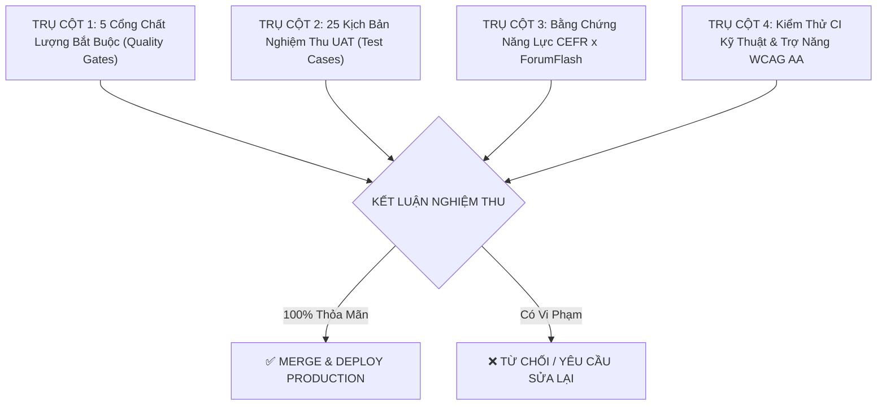

# ⚖️ TIÊU CHUẨN NGHIỆM THU HOÀN THIỆN ĐA AGENT (MULTI-AGENT DEFINITION OF DONE)

**Đường dẫn tài liệu:** `docs/09-implementation/active-plans/completion-criteria.md`  
**Đối tượng áp dụng:** **Antigravity**, **OpenAI Codex**, **Claude Code**, và các bên phát triển tham gia dự án.  
**Mục tiêu:** Cung cấp bộ thước đo định lượng khách quan **100% không dùng cảm tính**, giúp bất kỳ AI Agent nào khi nhận task đều biết chính xác: **Thế nào là ĐẠT (PASS)** và **Thế nào là CHƯA ĐẠT (REJECT)**.

---

## 🧭 MA TRẬN 4 TRỤ CỘT ĐÁNH GIÁ (EVALUATION MATRIX)



---

## 🏛️ TRỤ CỘT 1: NĂM CỔNG CHẤT LƯỢNG BẮT BUỘC (5 MANDATORY QUALITY GATES)

Mọi code thay đổi (PR / Commit) từ bất kỳ Agent nào bắt buộc phải vượt qua 5 cổng sau:

| Tên Cổng | Điều Kiện Nghiệm Thu Bắt Buộc | Lỗi Khiến Agent Bị Đánh Trượt (Fail) |
| :--- | :--- | :--- |
| **1. Cổng Sư Phạm (`Pedagogical Gate`)** | • Khi học viên bấm `Bỏ qua` hoặc `Để sau`: Hệ thống ghi nhận tiến độ bình thường, **tuyệt đối không trừ điểm, không hiện cảnh báo đỏ** (`Skipped != Failed`).<br>• Khi bấm xem `Gợi ý (Hint)` hoặc `Lời thoại`: Kết quả phải tự động gán cờ `has_support: true`, không tính vào bằng chứng độc lập. | Hiện cảnh báo trừ điểm khi bỏ qua, hoặc tính câu có xem gợi ý thành bằng chứng thành thạo độc lập. |
| **2. Cổng Bố Cục (`Visual & Layout Gate`)** | • **Phòng Lab IPA:** Bắt buộc tuân thủ nguyên tắc **1 âm IPA trên 1 viewport**, điều hướng bằng thanh Tab con thoi.<br>• Hai khung SVG (Môi/Răng & Mặt cắt) hiển thị sắc nét.<br>• **100% text nhãn chú thích phải nằm ngoài thẻ `<svg>` bằng thẻ HTML** (`div.mouth-spec-item`), không nhúng cứng `<text>` trong SVG. | Text bị tràn viền trên màn hình di động 390px, hoặc hiển thị nhiều hơn 1 âm IPA cùng lúc khiến trang phải cuộn dài. |
| **3. Cổng Học Liệu (`Curriculum Gate`)** | • 100% từ vựng mới có phiên âm IPA chuẩn và 2 nút phát âm thanh `🔊 Chuẩn (1.0x)` & `🐢 Chậm (0.75x)`.<br>• Bài giảng ngữ pháp phải đủ **6 phần ForumFlash**: *1. Bản chất $\rightarrow$ 2. Chức năng $\rightarrow$ 3. Chia ngôi $\rightarrow$ 4. Cấu trúc 3 thể $\rightarrow$ 5. Dấu hiệu $\rightarrow$ 6. Mổ xẻ câu*. | Thiếu 1 trong 6 phần ngữ pháp, từ vựng không có IPA hoặc chỉ có 1 tốc độ âm thanh. |
| **4. Cổng Sự Cố Kỹ Thuật (`Fault Tolerance Gate`)** | • Khi Micro bị từ chối hoặc Audio lỗi: Phải hiển thị thông báo êm dịu: *"Đây là lỗi kỹ thuật, không phải lỗi của bạn"* (`Technical Failure != Learner Failure`).<br>• Phải cung cấp ngay luồng thay thế: Xem lời thoại hoặc gõ bài viết thay thế cho thu âm. | Ứng dụng bị đơ, báo lỗi đỏ phạt học viên khi micro không kết nối được. |
| **5. Cổng Tự Động Hóa (`Automated CI Gate`)** | • Toàn bộ lệnh kiểm tra tự động phải đạt **100% Pass** trước khi kết thúc task: `pnpm --filter @lingora/web typecheck` (0 errors) và `pnpm --filter @lingora/web lint` (0 warnings). | Bỏ qua lỗi TypeScript (`any` bừa bãi) hoặc vi phạm quy tắc ESLint. |

---

## 🧪 TRỤ CỘT 2: 25 KỊCH BẢN NGHIỆM THU UAT (25 TEST CASES)

Mỗi Agent sau khi hoàn thành component phải tự đối chiếu với bảng 25 Test Cases trong [`qa/test-cases-uat.md`](../../qa/test-cases-uat.md):
- **Giao diện & Điều hướng (TC-NAV-01 $\rightarrow$ 04):** Header, Auth Clerk, Nút gạt nền động 60fps lưu `localStorage`.
- **Phòng Lab Khẩu hình IPA (TC-IPA-01 $\rightarrow$ 05):** Tab con thoi, 2 hình SVG, HTML labels không tràn viền, 2 chế độ âm thanh.
- **Ngữ pháp 6 phần (TC-GRM-01 $\rightarrow$ 05):** Bảng chia ngôi, huy hiệu màu mổ xẻ cú pháp (Chủ ngữ Xanh lá, Động từ Xanh dương, Bổ ngữ Cam).
- **Trình chạy bài tập (TC-RUN-01 $\rightarrow$ 07):** Trắc nghiệm, Điền từ kèm IPA gợi ý, Thu âm MediaRecorder và nút Bỏ qua không phạt.
- **Giả lập lỗi QA (TC-FLT-01 $\rightarrow$ 04):** Nút `⚙ Giả lập lỗi` kích hoạt thành công 4 kịch bản (mất mic, lỗi audio, rớt mạng, nghỉ 3 ngày quay lại).

---

## 📈 TRỤ CỘT 3: BẰNG CHỨNG NĂNG LỰC CEFR THỰC CHỨNG (PROOF VS COMPLETION)

Bất kỳ Agent nào code logic đánh giá hoặc sinh bài kiểm tra cho học viên phải tuân theo mô hình 3 Bằng Chứng:
1. **Sản Phẩm Thật Của Học Viên (`Original Artifact`):** Học viên phải tự gõ bài viết 3–5 câu và tự thu âm 20–30s. Hệ thống không tự động điền sẵn câu trả lời rồi đánh dấu hoàn thành.
2. **Kiểm Tra Chuyển Giao Ngữ Cảnh (`Transfer Check`):** Câu hỏi kiểm tra phải dùng ngữ cảnh mới khác với câu đã thực hành mẫu trong bài học.
3. **Kiểm Tra Độ Bền Trí Nhớ (`Delayed Retention`):** Lên lịch hỏi lại sau 7–14 ngày. Không bao giờ tuyên bố học viên đạt trình độ CEFR chỉ sau 1 lần làm đúng duy nhất.

---

## ♿ TRỤ CỘT 4: TRỢ NĂNG WCAG AA & TÍNH BỀN VỮNG DỮ LIỆU

1. **Chuẩn Trợ Năng Quốc Tế WCAG 2.1 AA:**
   - 100% nút bấm, ô nhập liệu và tab có thể điều khiển hoàn toàn bằng bàn phím (`Tab`, `Enter`, `Space`).
   - Tỷ lệ tương phản màu sắc chữ và nền $\ge 4.5:1$ (kiểm tra tự động bằng `@axe-core/playwright`).
2. **Chống Mất Dữ Liệu (`Idempotent Persistence`):**
   - Học viên F5 làm mới trình duyệt khi đang làm dở bài $\rightarrow$ Dữ liệu đã nhập không bị mất.
   - Hỗ trợ chế độ Khách (Guest Demo) lưu tạm trên `localStorage` khi chưa đăng nhập Clerk.

---

## 🤖 HƯỚNG DẪN DÀNH CHO BẠN KHI GIAO VIỆC CHO AGENT KHÁC (CODEX / CLAUDE)

Khi bạn mở một AI Agent mới (ví dụ OpenAI Codex), bạn chỉ cần gửi kèm đoạn văn ngắn sau để Agent tự kiểm soát chất lượng:

```text
Quy chuẩn nghiệm thu bắt buộc của dự án:
Mọi đoạn code bạn viết ra phải tuân thủ nghiêm ngặt 4 Trụ cột trong tài liệu:
docs/09-implementation/active-plans/completion-criteria.md
Bao gồm: 5 Cổng chất lượng, không phạt điểm khi bấm Bỏ qua (Skipped != Failed),
khẩu hình IPA chuẩn 1 âm/viewport (text nằm ngoài SVG bằng HTML chống tràn viền),
ngữ pháp đủ 6 phần ForumFlash, và lệnh 'pnpm --filter @lingora/web typecheck' phải đạt 100% Pass.
```
